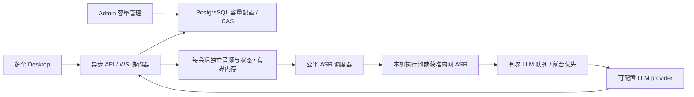

# 并发与容量设计（v0.3 · 当前目标 20 路）

2026-10-17。用户将上一轮 50 路目标调整为 **20 路**，要求后台可调并提前考虑服务器更高并发。本文件将旧差异记录落实为开发契约；描述均为待实现设计，未进行真实容量压测。方案 B 功能、三端技术栈与原有隐私/插入保护不变。

## 1. 整体思路与边界

20 路指 **20 个不同账号同时录音、识别或整理**，各自获得正确归属的结果，包含同时停止的突发。在线账号、空闲 WebSocket 数、仅接收音频或大量回退原文都不能充当容量成绩。每账号仍最多一个活动会话。

拆开三层：后台调整活动会话接纳数；部署配置 ASR 执行池与 LLM 调用池；压测报告记录实际验证容量。20 是当前验收目标，不是数组长度、代码常量上限或硬件能力声明。允许本机调低到 1/5/10 做功能开发，但必须记录 20 路尚未通过。未来服务器按相同负载脚本测 50/100 或自定 N，无需重写业务流程。

当前采用一个异步 API 协调器、一个数据库、可独立扩展的模型资源。单协调器不等于单用户；不凭空引入 Redis/Kubernetes。先横向扩充内网模型服务、调整已实测执行并行度；只有 API 自身成为实测瓶颈才进入第 8 节的多协调器演进门禁。

## 2. 配置与后台生效规则

| 项 | 初始值 / 规则 |
|---|---|
| `sessions.initial_max_active` | 20，仅首次初始化数据库容量记录使用 |
| `sessions.admission_ceiling` | 20，部署上限，可设置更高正整数（数据库int32范围）；不表示实测吞吐 |
| `audio.active_pcm_budget_bytes` | 134217728（128 MiB）；只含协调器原始 PCM 池，不含模型/工作缓冲 |
| 有效部署上限 | `min(admission_ceiling, floor(active_pcm_budget_bytes / 5760000))`；启动校验≥1 |
| `runtime_capacity.max_active_sessions` | 管理员运行时设置，1～有效部署上限；初始 20；数据库为权威 |
| `sessions.per_user / queue_size` | 固定 1 / 0；**会话接纳不排队**，与模型内部有界等待分开 |
| `asr.execution_slots` | 本地起步 1；根据模型资源测定，绝不按每个用户复制模型 |
| `asr.decode_timeout_ms` | 3000；普通窗口单次执行硬超时，收尾按 10000ms 总预算 |
| `llm.max_inflight / classify_queue_size` | 起步 4 / 20；需符合上游配额，4 不代表本地模型能同时算 4 路 |
| `llm.foreground_wait_ms / classify_wait_ms` | 2000 / 1000，包含在原总 deadline 内，不额外叠加 |
| `retry.max_cached_sessions / audio_budget_bytes` | 20 / 134217728，独立失败缓存池；资格TTL 600秒，收尾上限见第6节，不延长推理时间 |

本地起步配置是调度边界，**不是“ASR 1 + LLM 4 一定能支撑 20 路”**。本机不足时下调运行上限；服务器部署提高 ceiling 与 PCM 预算后，后台即可设置更高数值。模型实例数、显存、provider 地址/密钥不在后台热改；由部署配置与发布负责。

初始化用 WHERE NOT EXISTS，重启不覆盖管理员已保存值。已有值大于新有效部署上限时 readiness 失败（`CAPACITY_CONFIG_INVALID`），只开放鉴权/管理/诊断以便管理员纠正，不静默截断。数据库读写失败不能回落到默认值接单。

保存使用 `version` CAS，事务提交后读回配置才提示成功。调低上限须二次确认（尤其低于当前活动数时）；在途任务继续，活动数 **严格小于** 新上限后才接纳下一个。调高只增加接纳额度，不自动扩充模型资源。后台配置支持int32正整数；JSON安全整数校验仍不能越过数据库范围。保存超时显示“结果待确认”，重新 GET 对照版本和值，禁止自动覆盖重试。冲突保留输入供比对，刷新后由管理员重新提交。普通用户不得访问容量详情或修改。

## 3. 原子接纳、状态与数据库

接纳事务固定READ COMMITTED隔离级别，取得容量行锁后再执行活动数查询，避免旧快照超卖。create/retry/容量 PATCH 都先 `SELECT runtime_capacity FOR UPDATE`。create/retry 在同一短事务内依次检查用户/session、现有幂等结果、每用户唯一约束、数据库活动数与最新容量，预留 PCM 配额，再写 session/attempt；失败回滚并归还预留。幂等重放在容量检查前返回原对象，不另占槽。按容量行→user→session→dictionary_state 的顺序获取需要的锁，其他终态/学习路径不反向请求容量锁。

活动数按数据库 `created/streaming/finalizing/refining` 计算，使用活动状态部分索引。不能对内存整数先查后加造成超卖。退出活动状态与统计同事务；已终态资源释放幂等。DB 连接不贯穿录音、模型等待或整个 WS 生命周期；锁内不做推理、网络调用、文件 I/O。数据库不可用先拒绝接纳，不先启动模型。

协调器的 create/retry 在获取数据库连接前先等待同一进程内短事务互斥，防止大量等待容量行锁的事务占满连接池；取得连接后仍按上述数据库锁和实时活动数判断。互斥只覆盖接纳事务及运行态发布，不跨 provider 初始化、模型等待或 WS；满员仍立即返回429，不排队等待活动会话释放。已锁容量行在同一事务内复用，不重复发起同一行的锁查询；取消等待者不留下业务记录或连接占位。

新录音预留每路最大 5760000 bytes（逻辑额度，不要求立即分配物理内存）；ASR成功即释放实际PCM，初始录音的逻辑预留保持至attempt终态归还，避免在途额度反复分配；ASR retry 从缓存池原子转移所有权到活动池，失败再转回，截止时间不变；refine retry 无音频预留但占活动会话额度。业务槽释放与真实 worker 资源释放分开：取消后旧计算未停止时执行槽仍占用，直到退出或杀掉其独立 worker 并确认清理；不能重复分配同一资源。

WS 处理只做鉴权、帧校验、受限缓冲写入、ACK、事件发布。解码不在事件循环运行；不能为每个 250ms 帧创建推理任务或长期 DB 事务。每会话最多一个 writer 和有界事件缓冲；partial 合并为最新版本，ACK 可合并为最新累计样本数，终态不可丢；慢客户端超时关闭，其他会话不被拖住。音频累计在内存按样本计，终态/结束必定落库；运行中元数据检查点最多每秒一次，ACK 表示接收而非磁盘持久化，崩溃按原重启失败规则恢复。授权状态批量检查仍须保证撤销≤5秒。 活动watchdog对齐协调器共同的单调时钟轮询边界（间隔不大于1秒，首查可更早），同tick合并身份三元组`user_id/login_sid/session_id`，一次VALUES与租户限定outerjoin读取；不跨轮缓存授权。每个消费者独立保留原1秒读取期限，包含等待、checkout、查询与释放；一人取消或超时不取消其他仍有效消费者。查询失败仍明确failclosed，不冒充撤销。WS期间sid变化须在原期限内重新读当前身份。停机先停止消费者，再等待共享查询完成取消和连接归还，避免二次取消打断清理。

## 4. ASR 调度与隔离

- 所有任务带 `(user_id, session_id, attempt_no, generation, deadline)`，回调校验当前代；音频、稳定前缀、词库快照和 decoder 状态独立，不得共享可变提示。
- 每会话最多一个正在执行任务、一个最新 partial 待执行项；新的窗口替换旧待执行项。收到 end 时移除该会话待执行 partial，增加一个 finish，等待正在执行的窗口退出后处理未稳定尾部。partial 队列、finish 队列各不超过有效部署上限，按会话 ID 去重；不按历史帧数增长。
- 调度以实际发起任务计 3 个 finish : 1 个 partial；某队列为空时借用，队列内部按入队顺序轮转。替换 partial 保留原排队位置；取消/已超时项立即移除。优先收尾且其他录音不被无限饿死。普通 decode 最长 3000ms，故公平机会由执行完成/硬超时推动；deadline 先于优先级判断。
- finish 等待与执行合计≤10000ms，且不越过 stop→result 30000ms / 音频缓存绝对截止。超时按 `ASR_TIMEOUT` 失败；运行资源耗尽/故障按现有 `ASR_FAILED`，诊断 reason 标 `resource_exhausted`。不谎报 empty，不伪造稳定 partial。
- 有租户记账的partial/finish在原3/10秒deadline内预留现有1秒终态写账，不增加队列、attempt或失败音频TTL。预热、started、物理decode共享余下执行窗口，预算不足不派发、不造call。取消/异常每个worker代际只有一个stop owner；所有调用者包括重复取消均等待实际退出确认，才允许重建或复用。SIGTERM宽限100ms后升级kill，kill后仍join确认（最多1秒）；无法确认时保留隔离、health=false，不以清句柄冒充退出。极端停止/数据库故障可导致原预算内终态未确认，明确诊断并按准确身份恢复，未知token不造0。
- 本地执行池每个 worker 同时一个 decode，模型实例数取决于显存与 adapter 支持；会话状态由独立上下文保存/路由。单任务取消可终止其 worker，其他 worker 与未执行会话不受牵连。该 worker 重新 prepare 后才可回池；工作副本释放后才确认取消完成。
- 内网 ASR 可通过同一 provider 接口扩展。adapter 必须报告实际执行容量、支持期限/取消/健康与会话隔离；有状态 decoder 固定路由到所属节点，节点失效本轮失败，不无条件重放。远端清理必须可确认，否则该节点退出就绪且故障验收不通过。无状态窗口才可分配到不同节点。批处理是可选 adapter 优化，验证状态隔离后才启用；当前默认不批处理，不能取消一人时杀掉同批其他人的任务。

## 5. LLM 调度、配额与过载

整理使用前台队列（第二次LLM审核已按2026-10-19用户决定取消），每 attempt 同时最多一个调用待执行或运行；前台队列长度≤有效部署上限。学习分类独立队列≤20（可配置），每用户最多一个分类待执行/运行，超出标 event failed/MODEL_BUSY。两类任务共享 `max_inflight`，按 3 个前台 : 1 个分类分派，同类 FIFO，空队列借用；不抢占已发出的调用。

前台最多等 2000ms，分类最多等 1000ms；单次实际调用最多10000ms，分别受原 attempt 总30000ms/event 总10000ms约束。refine 最多一次原有许可的自动重试；调度等待也算预算。排队未发出的任务不记模型调用/用量，只记 queue_wait/error 指标；仅决定实际发出时先持久化call，再发请求；取消后的外部费用可能unknown。LLM max_inflight约束本服务发起且尚未归还许可的请求，不能保证第三方内部真实执行数。主动取消后保守保留许可至请求原deadline或明确终止回执，标用量unknown；原deadline后若供应商仍可能执行，记未知在途诊断，不谎报远端已停止，上游物理容量还须供应商限额保证。

有租户记账的 LLM 调用须在同一原总预算内预留现有最多1秒的终态持久化时间：实际请求截止取 `min(原总deadline−1秒, 派发开始+单次调用上限)`。排队前和实际派发前都检查，剩余不足时 timeout，不新建call或请求；不增加模型、重试或后台补写预算。分类最多约9秒物理窗口，前台仍有足够总预算时单次最多10秒。已发请求到期后以 unknown/timeout、未知token=null真实落库，提前主动取消保持 CLIENT_INTERRUPTED。数据库在预留窗口仍不可用时明确记录未确认终态，不能伪造成功或已知0；按既有准确身份恢复规则处理。

队列满/等待到期：分类 failed/MODEL_BUSY；前台回退 raw、review=true，对应 llm_unavailable，内部 error=MODEL_BUSY。已开始调用超时仍用原超时原因。限流429不立即循环重试；遵守上游 Retry-After（无有效值用1000ms，最长60000ms冷却），冷却期间新任务不发出，等待预算先到则按 MODEL_BUSY 处理；inflight 上限本身不能替代供应商 RPM/TPM 额度。容量报告须记录这些额度，选型后压测，不能让大量回退充当20路正常整理。

## 6. 内存、容量状态与观测

原始 PCM 每路32,000B/s，180秒=5,760,000B；20路持续0.64MB/s、最大115.2MB；50路1.60MB/s、288MB；100路3.20MB/s、576MB。单位为十进制，均不含协议、模型、float工作缓冲和失败缓存。执行池工作副本按执行并行度分别预算，内网节点同样要有内存/显存限额。不能把上述原始音频值当整机需求。

失败缓存同时受数量、字节与600秒资格约束；先移除过期，再按最早到期（同期限session_id）淘汰可回收项。以首次失败+600秒为D，重试/转池/回滚不重置：到D立即禁止新ASR重试、过期音频派发和迟到ASR输出提交；本地服务进程PCM最迟D+1秒清空，独立worker最迟D+2秒退出确认，两期限并行、不串成3秒，执行许可在确认前不归还、不复用。清理不等待DB状态写入，超限或无法确认时继续隔离并报告失败；此收尾不是推理/结果宽限，不延长3/10/30秒模型预算。已用于重试的音频转入活动池并计其预算；失效但尚在物理收尾的资源仍计实际占用。达到预算不得无限复制音频，缓存淘汰更新retry_kind/reason。不因管理员降容提前清掉在途音频。

后台显示：已保存上限/有效部署上限/当前活动数/可接纳数/降容排空状态；ASR和LLM运行及等待数；最近5分钟拒绝数、失败/回退数、stop→result p50/p95与样本量；PCM实际/预留/失败缓存bytes；采样时间。0样本时延为null显示“暂无样本”，运行状态不可取为unknown，不显示0冒充空闲。每5秒刷新，失败保留最后采样并标过期；不能用轮询消耗模型调用。

已验证容量为独立的只读部署报告摘要：无报告为null“未验证”；报告关联app/配置/OS/硬件/模型/配额/负载脚本摘要与时间，不可由管理员填写一个数字。运行上限变动不改变底层资源指纹；当其高于报告N时提示超出验证范围，模型/资源变更则报告stale。报告仅说明固定环境结果，不构成容量硬限制或健康保证。

## 7. 验收目标与实施节奏

沿用单并发 A10/A30 停止到原生读回 p50≤2000ms、p95≤5000ms。新增20路负载使用相同目标，ASR稳定partial/忠实整理与用户隔离同时满足；正常固定语料中不得发生过载拒绝、模型错误或原文回退。失败不删样本，正常处理容量不能用降级吞吐替代。具体固定负载、统计与2小时稳定性方法见测试 fixtures 的 F-CAPACITY。

一台桌面只有一个真实焦点，不能伪造20个同时原生插入。用19个协议负载客户端+1个真实Desktop验证带负载的原生链路，同时记录20路服务端结果；服务器未来N路沿用N-1+1。取消/断网/模型故障另组测试，故障注入成绩不混入正常容量。

- M1 三端骨架同步建立租户隔离、原子接纳、容量管理与有界调度接口；模型可用Mock验证控制分支。
- M2 接真实ASR/LLM/原生输入后按1→5→10→20压测，及早发现硬件/provider瓶颈。未达到20如实记录当前上限与失败原因，不改验收标准。
- 后续词库/学习/统计接入时重跑混合负载，最终完成稳定性、全部应用用例及两个平台基线。Windows不因本轮并发调整被移出范围。
- 上服务器先复验20，再按50/100/自定N提高部署上限、PCM预算与实测推理资源；使用同一参数化测试报告，不预先承诺未知服务器成绩。

## 8. 更高并发的演进门禁

模型扩容应封装在 AsrProvider/LlmProvider 与有界调度器，不改客户端音频协议、业务状态机或租户键。当前单协调器可配置高于20的容量，实际极限由压测决定。

若需要多API副本，必须另立设计/迁移并验证：全局原子接纳及带期限租约、owner_instance+epoch栅栏、HTTP/WS一致的归属路由、owner失效回收、跨节点取消、幂等提交/全局限流、全局容量指标。音频保持owner内存，不把个人音频放进Redis或数据库；owner丢失允许当前会话明确失败/重新录音，不声称无损迁移。未完成这些验收前仍拒绝多Uvicorn worker/多应用replica，不能复制进程内计数冒充扩容。

## 9. 技术依据与未知项

[FastAPI并发说明](https://fastapi.tiangolo.com/async/)支持区分网络等待与计算并行；[PostgreSQL行锁](https://www.postgresql.org/docs/16/explicit-locking.html)与[READ COMMITTED快照规则](https://www.postgresql.org/docs/16/transaction-iso.html)支持短事务串行化配置与接纳；[Triton调度文档](https://docs.nvidia.com/deeplearning/triton-inference-server/user-guide/docs/user_guide/batcher.html)区分无状态批处理与有状态序列。这里据其原则设计，不要求引入Triton，也不把文档当成本项目性能证据。

P1仍缺真实服务器硬件、首用模型/量化/适配器及LLM额度，决定最终执行池大小；P2仍缺Windows和实际录音证据。上述未知项不妨碍接口开发，但未实测不得标20路已支持或S5已通过。
